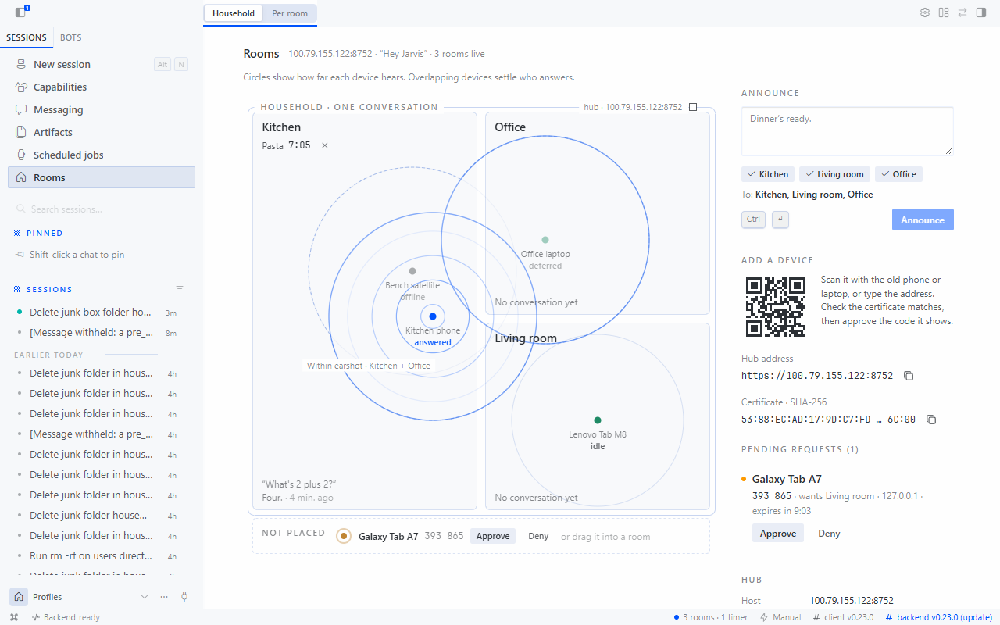
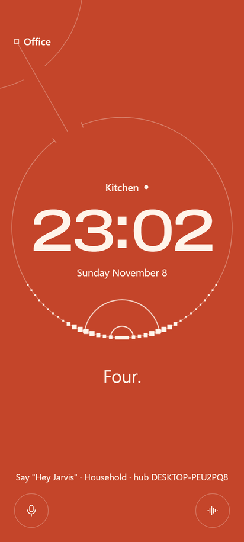
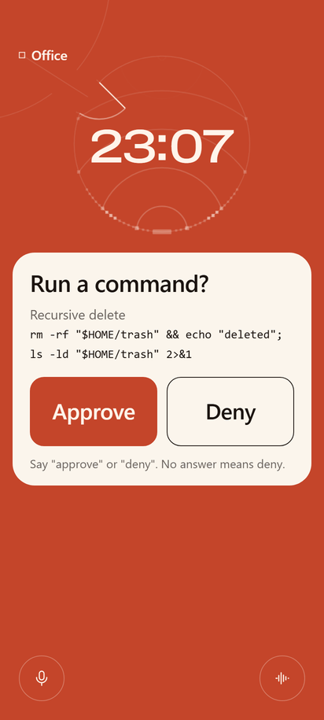
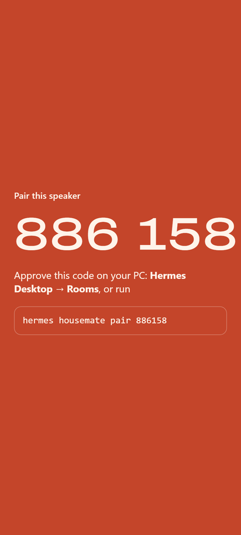
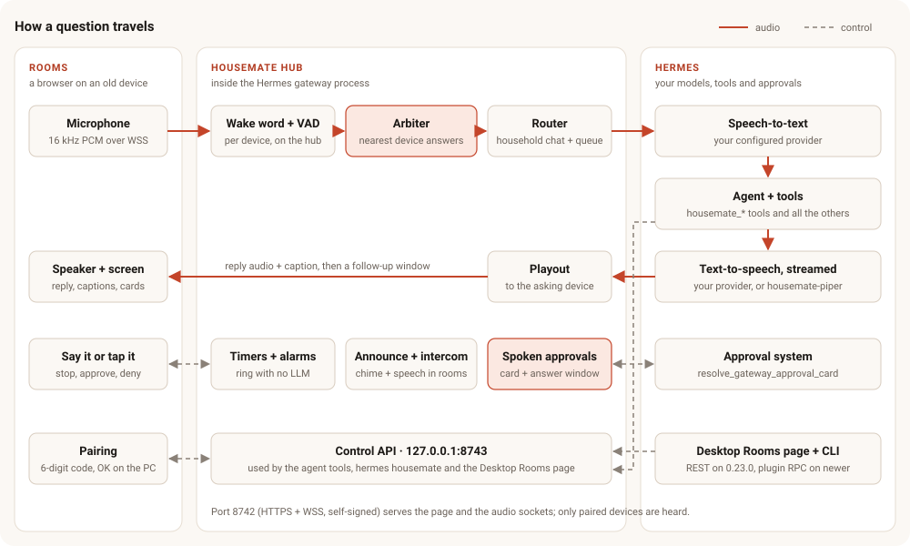
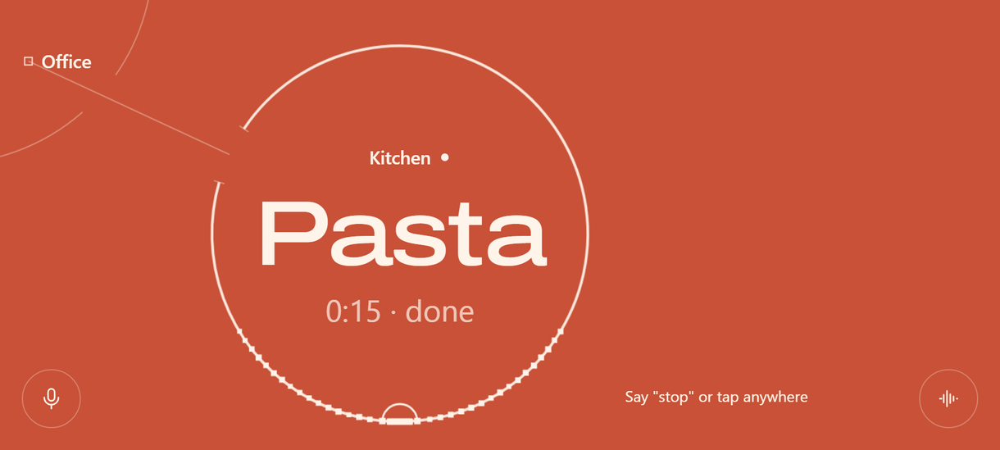
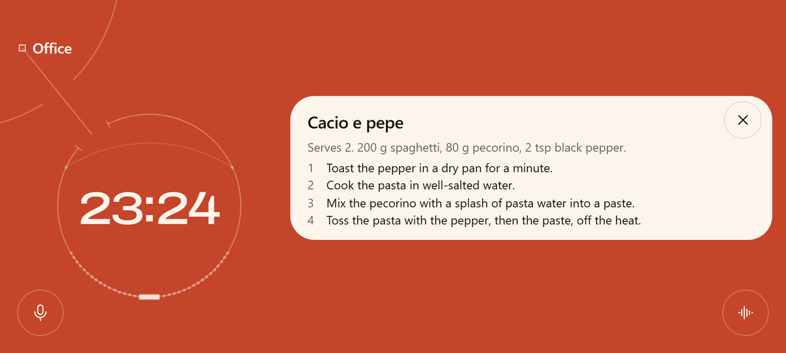
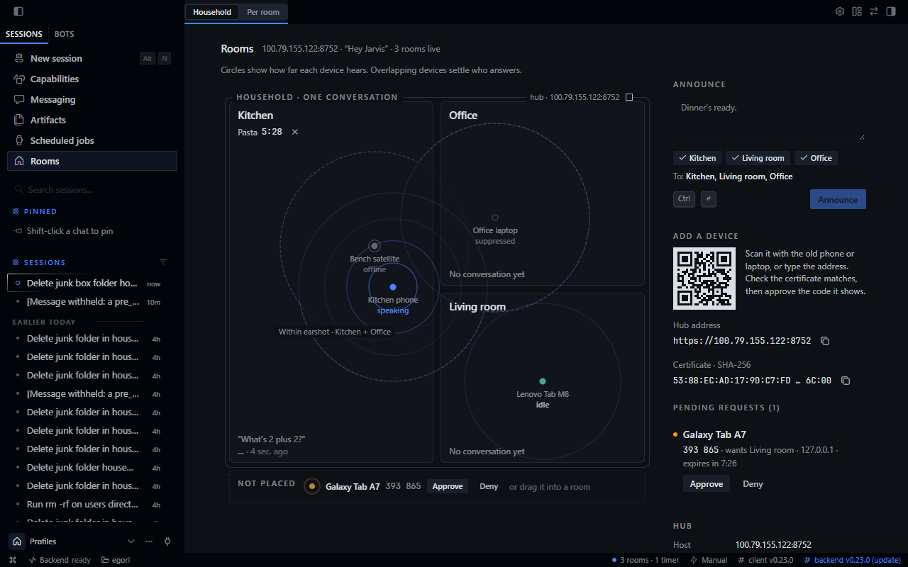
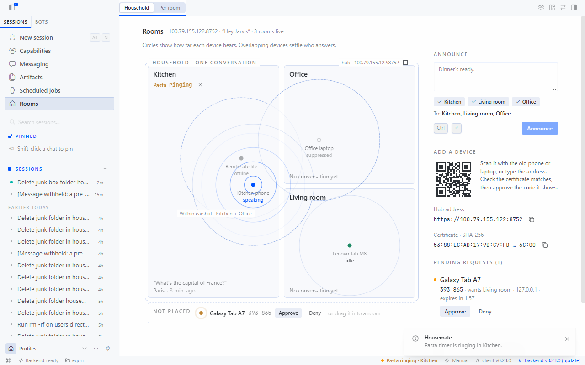

# Housemate

**Hands-free Hermes in every room. Say the wake word, ask, and hear the answer in the same room <!-- num:latency_p50 -->2.6 s<!-- /num --> after you stop talking.**

Most homes have a drawer of old phones. Housemate turns them into room speakers for your own Hermes: the Alexa routine (a pasta timer that rings in the kitchen, "tell the office dinner's ready", "stop") from an assistant that is actually your agent, with your tools, your memory and your approvals. There is no hardware to buy and no app to install. You need a browser, a QR code and a six-digit pairing code.



| | | |
|---|---|---|
|  |  |  |
| The kitchen asked, so the kitchen answers. | Hermes asks before `rm -rf`. Say "approve" or "deny", or tap. | Pair a device once with a six-digit code. |

## What it does

- **Rooms.** Any phone, tablet or laptop with a current browser becomes a speaker in a named room. You approve each new device on the PC.
- **One household conversation.** Every room feeds one Hermes conversation, and each question carries its room. Set a timer in the kitchen, then ask from the office how long is left. The answer is spoken in the room that asked. `conversation: per_room` gives each room its own conversation instead.
- **The nearest device answers.** When two speakers hear the same wake word, the hub settles it within 400 ms: one answers and the others stay quiet.
- **Timers and alarms that ring where you set them.** They are kept in SQLite, ring with no model call, and survive a restart. Say "stop" (no wake word needed) or tap the screen.
- **Intercom and announcements.** "Tell the kitchen dinner's ready" is spoken in the kitchen. On a speaker, tap the other room's name and talk to send a voice message.
- **Room screens.** Recipes, lists and steps go on the screen as a card while Hermes says one sentence about them.
- **Spoken approvals.** When Hermes needs your OK for a command, the speaker in that room reads it out and shows Approve and Deny. Answer out loud or tap. No answer means deny.
- **A Rooms page in Hermes Desktop.** A live plan of the home: every device and how far it hears, what each one is doing, which device won the last wake word, running timers, the last exchange per room, an announce box and pairing by QR code.
- **Everything else Hermes does.** Email, files, the web, Home Assistant and your other plugins, by voice, through the same agent.

## Quick start

About a minute of typing, plus a one-time dependency install. You need Hermes <!-- num:hermes_version -->0.23.0<!-- /num --> or newer with speech-to-text turned on (`stt.enabled: true`, any provider) and a text-to-speech voice.

```bash
hermes plugins install housemate        # from the catalog
hermes plugins enable housemate         # installs aiohttp, numpy, onnxruntime, cryptography, qrcode
hermes config set platforms.housemate.enabled true
hermes config set webapp.enabled true   # if the Webapp is not on yet
hermes gateway restart
hermes webapp                           # then open Rooms in the sidebar
```

1. Scan the QR code on the Rooms page with the old phone (it must be on the same Wi-Fi). `hermes housemate cert` prints the same address and QR code in a terminal.
2. The phone's browser warns about the self-signed certificate. Check that the fingerprint matches the one on the Rooms page, then continue.
3. Name the speaker, pick its room, and approve its six-digit code on the Rooms page (or run `hermes housemate pair 123456`).
4. Press **Tap to start**, put the phone down and say **"Hey Jarvis, set a pasta timer for nine minutes."**

The default rooms are Kitchen and Office. Add more from a speaker's room picker or with `hermes housemate rooms add Living Room`.

## Try it without hardware

Two browser windows on one PC make two rooms.

1. Follow the quick start up to `hermes webapp`.
2. Both windows will hear the same microphone, so put both rooms in one earshot group. The hub then picks one device per wake word and does not take follow-up questions while either window is speaking:

   ```bash
   hermes housemate rooms group Kitchen desk
   hermes housemate rooms group Office desk
   ```

3. Open `https://localhost:8742` in one Chrome window and `https://127.0.0.1:8742` in a second window beside it. The two addresses make two separate devices; two tabs at one address would share a single device identity. Accept the certificate warning in each.
4. Name them, put one in **Kitchen** and the other in **Office**, approve both codes on the Rooms page, and press **Tap to start** in each. (A window that was already open picks up a new earshot group when you reload it.)
5. Say "Hey Jarvis, what's two plus two?". One window answers, and the Rooms page marks the other one *deferred*. To talk to one window in particular, **hold its talk button** and speak; no wake word is needed.
6. Then try a few things, holding the talk button of the window named:
   - Kitchen: "Set a tea timer for twenty seconds." Office: "How long is left on the tea?" Twenty seconds later the Kitchen window rings; say "stop".
   - Office: "Tell the kitchen dinner's ready."
   - Make a folder `housemate-demo` in your home directory. Kitchen: "Delete the housemate-demo folder in my home directory." Answer "deny", then ask again and answer "approve".

Headphones help too: they keep the reply out of the microphone.

## How it works



- **Satellite.** The hub serves a small web page: no build step, no WebAssembly. After *Tap to start* it streams 16 kHz mono microphone audio over a secure WebSocket, using the browser's echo cancellation, noise suppression and gain control. It keeps the screen on with a Wake Lock and plays the audio it receives. An old phone only has to run a web page.
- **Wake word and VAD on the hub.** Each device gets its own listener in the gateway: openWakeWord (on onnxruntime) for the wake word, and Silero VAD to find the end of the question (700 ms of silence). The stream stays in memory. Only the question itself, from just after the wake word to the end of speech, is handed to Hermes.
- **The nearest device answers.** Detections from one earshot group (a room, or rooms you group together) within 400 ms form a round. The highest wake score wins; a near tie goes to the louder device, the one you are probably facing. The others drop what they captured. While any device in the group is playing, the wake threshold goes up and no follow-up listening starts, so a speaker does not wake itself.
- **Household queue.** In household mode all rooms share one Hermes session. The room reaches the model as this turn's channel prompt and as `[room: Kitchen]` in the history, and the reply goes back to the device that asked. If another room speaks during a turn, its question waits in a queue: handing it over would interrupt the running turn and cancel any approval it is waiting on.
- **Streaming speech.** Hermes's streaming TTS is paced out to the asking device only, with the reply text as a caption. When playback ends, a 6-second follow-up window takes the next question without the wake word. Saying the wake word during playback stops it. The plugin also registers `housemate-piper`, a TTS provider that streams a local Piper voice sentence by sentence.
- **Approvals.** Hermes's approval prompt becomes a card on the room's screens and a spoken question on the asking device. Once the question has played, a 10-second window takes the answer without the wake word. The clip goes to a side chat, Hermes transcribes it with your STT, and the plugin's `pre_llm_call` hook reads it, resolves that card with Hermes's `resolve_gateway_approval_card`, and vetoes the side turn.
  - The parser is strict. The whole answer must be a short approve or deny phrase ("approve", "yes", "go ahead"; "deny", "no", "cancel") with no question in it. Anything else is asked again and in the end times out as a deny.
  - Audio that overlaps the hub's own playback, and text the hub announced, never counts as an answer.
  - A command flagged by Hermes's smart approval can only be approved by a tap. Taps count only from allowed devices in that room that were shown the card.
- **Timers.** A scheduler inside the hub, stored in the plugin's SQLite database. A ring is a chime plus the spoken label in the timer's room, repeated every 20 s until stopped (for up to 3 minutes), with no model call. While a timer rings, "stop" works without the wake word.
- **Rooms page.** `desktop/plugin.js` uses only the Desktop plugin SDK. On Hermes 0.23.0 it calls the plugin's REST routes (`/api/plugins/housemate/*`, behind the dashboard sign-in); on builds with plugin RPC it calls `plugin.housemate.rooms.*`. Live updates arrive as the `plugin.housemate.rooms.changed` event.

## Screens

| | |
|---|---|
|  |  |
| The timer rings in the room it was set in. Say "stop" or tap anywhere. | Long answers go on the screen; Hermes says one sentence. |
|  |  |
| The Rooms page follows the Desktop theme. | A ringing timer shows on the plan, in the status bar and as a notification. |

## Numbers

Every number here is copied from `results/*.json` by `scripts/render_numbers.py`. `hermes housemate bench` measures them again on your machine.

| Measure | Result |
|---|---|
| Time from the end of your question to the first word of the answer (median / p95) | **<!-- num:latency_p50 -->2.6 s<!-- /num -->** / <!-- num:latency_p95 -->3.2 s<!-- /num -->, <!-- num:latency_runs -->20<!-- /num --> warm runs |
| Wake word recall, clean | <!-- num:wake_recall -->100 %<!-- /num --> of <!-- num:wake_recall_n -->58<!-- /num --> clips |
| Wake word recall with speech 10 dB lower in the background | <!-- num:wake_recall_noisy -->95 %<!-- /num --> |
| False wakes | <!-- num:wake_fa_per_hour -->0.11<!-- /num --> per hour (<!-- num:wake_false_accepts -->1<!-- /num --> in <!-- num:wake_negative_hours -->9.2<!-- /num --> h of audiobook speech) |
| Tests | <!-- num:tests_passed -->458<!-- /num --> passing on Hermes <!-- num:hermes_version -->0.23.0<!-- /num --> |

- **Latency** runs from the last frame of speech (found by Silero VAD in the clip, which is sent in real time like a satellite) to the first frame of reply audio arriving at the satellite, on the same PC as the hub, with one-word answers.
- **Machine:** Ryzen 5 5600X, RTX 4060 8 GB, Windows 11.
- **Speech-to-text:** Hermes's local faster-whisper, model `small`, on the GPU.
- **Voice:** `housemate-piper` with `en_US-lessac-medium`.
- **Model:** `deepseek-v4-1-flash-1017-ultrafast` through Venice, as a custom provider.
- **Wake word:** the default `hey_jarvis` model at threshold 0.5, on 10 committed clips plus 48 clips from 24 Edge neural voices, and 9.2 h of public-domain LibriVox recordings. Sources and licences are in [bench/corpus.md](bench/corpus.md).

## Recommended setup

This is what the numbers above ran on. Any Hermes STT, TTS and model will work; these choices decide how fast an answer starts.

```yaml
stt:
  enabled: true
  provider: local
  local:
    model: small             # base.en is slightly faster but mishears short commands
    device: cuda
    compute_type: float16
tts:
  provider: housemate-piper  # streamed Piper, registered by this plugin
  piper:
    voice: en_US-lessac-medium
model:
  provider: custom           # any fast model with tool calling
  base_url: https://api.venice.ai/api/v1
  key_env: VENICE_API_KEY
  default: deepseek-v4-1-flash-1017-ultrafast
  context_length: 200000
platforms:
  housemate:
    enabled: true
    # end_silence_ms: 500    # answers 0.2 s sooner, may cut off slow speakers
```

- `housemate-piper` needs the `piper-tts` package that Hermes's own Piper voice uses. Without it the provider reports itself unavailable and Hermes falls back as usual. The voice is loaded at start-up, before anyone speaks.
- Voices that only produce whole files (Hermes's built-in Piper, Edge) work too, but the gateway can play a whole file only after the turn ends. In our runs that started the answer about 2.7 s later.
- A cloud voice that streams also works; in our runs it started about 1.4 s later than local Piper.
- Local speech-to-text needs the GPU to itself. Another job filling the GPU's memory stalled transcription for tens of seconds.

## Configuration

Keys go under `platforms.housemate` in Hermes's `config.yaml`. A bad value is logged once and replaced by its default.

| Key | Default | What it does |
|---|---|---|
| `enabled` | `false` | Hermes's switch for the platform. |
| `conversation` | `household` | `household`: one conversation for the whole home. `per_room`: one per room. The Rooms page can switch it. |
| `rooms` | `[Kitchen, Office]` | Rooms created at start. More can be added from a speaker or the CLI. |
| `earshot_groups` | `{}` | Room name → group name. Devices in one group hear each other: one wake round and one echo guard for all of them. |
| `port` | `8742` | LAN port of the hub (HTTPS and WSS). |
| `bind_host` | `0.0.0.0` | Address the hub listens on. |
| `advertise_host` | empty | Host name or address shown first in the QR code and by the CLI. Empty: the best LAN address. |
| `control_port` | `8743` | Port of the loopback control API (always 127.0.0.1). |
| `tls` | `true` | Self-signed HTTPS. Phone browsers only give a web page the microphone over HTTPS; turn it off only behind your own TLS proxy. |
| `wake_model` | `hey_jarvis` | A stock openWakeWord model name, or the path to an openWakeWord-format `.onnx` head. |
| `wake_threshold` | `0.5` | Wake score needed to wake (0.05 to 0.99). |
| `vad` | `silero` | `silero`, or `energy` (no model download, less accurate). |
| `end_silence_ms` | `700` | Silence that ends a question, in ms (300 to 2000). |
| `followup_s` | `6` | Seconds after an answer during which you can speak without the wake word (0 turns it off). |
| `answer_window_s` | `10` | Seconds to answer an approval or a question without the wake word. |
| `turn_timeout_s` | Hermes's approval timeout + 60 s, at least 360 | Safety net for a household turn that never finishes. A turn waiting on a prompt is never timed out. |
| `prewarm` | `true` | Warm up Hermes's STT and TTS at start, so the first question is not slow. |
| `speak_replies` | `true` | Speak replies on this platform. `false` shows captions only. |

Settings in Hermes's `.env` (all optional):

| Variable | What it does |
|---|---|
| `HOUSEMATE_HOME_CHANNEL` | Room that speaks cron deliveries addressed to `housemate`, for example `kitchen`. |
| `HOUSEMATE_ALLOWED_DEVICES` | Comma-separated device ids that may talk to Hermes. Empty: every paired device. |
| `HOUSEMATE_ALLOW_ALL_DEVICES` | `true` lets every paired device talk even when `GATEWAY_ALLOWED_USERS` is set. |

If you set `GATEWAY_ALLOWED_USERS` for another platform, Hermes applies it here too. List your device ids (`hermes housemate devices`) in `HOUSEMATE_ALLOWED_DEVICES`, or set `HOUSEMATE_ALLOW_ALL_DEVICES=true`. The hub only ever hears paired devices either way.

## Tools, commands and CLI

**Agent tools** (toolset `housemate`, in every Hermes session, the CLI included):

| Tool | What it does |
|---|---|
| `housemate_rooms` | Rooms, the devices online in each, what each room is doing, running timers. |
| `housemate_announce` | Speak a message in other rooms (intercom). |
| `housemate_timer_set` | A countdown timer that rings in a room. |
| `housemate_alarm_set` | A one-off alarm at a local time (HH:MM). |
| `housemate_timer_list` | Running timers and alarms with the time left. |
| `housemate_timer_cancel` | Cancel or silence timers by label, room or id. |
| `housemate_show` | Put a card with a title and text on a room's screen. |

**Slash commands:** `/housemate` (rooms, devices and timers) and `/announce <text>` (spoken in every room).

**CLI:**

```text
hermes housemate status                      rooms, devices and timers
hermes housemate cert                        hub address, certificate fingerprint, QR code
hermes housemate pair 123456                 approve the device showing this code
hermes housemate devices                     paired devices
hermes housemate revoke <device-id>          unpair a device
hermes housemate rooms add|remove <name>     manage rooms
hermes housemate rooms group <room> [group]  put a room in an earshot group
hermes housemate bench [wake latency tests]  measure; writes results/*.json
```

**Automation Blueprints:** `housemate:morning` (a spoken morning briefing), `housemate:bedtime` (a spoken goodnight) and `housemate:remind` (a spoken reminder). Any cron job can deliver to `housemate` (the home room) or `housemate:<room>`.

**Skill:** `housemate` tells the model when to speak and when to show a card, when to use a timer and when cron, and how to announce.

**Hook:** `pre_llm_call`. It acts only on the plugin's own "Housemate answers" side chat and ignores every other message.

## Disclosures

| What | Details |
|---|---|
| LAN server | An HTTPS + WSS server inside the gateway process on `0.0.0.0:8742` (`bind_host`, `port`). It serves the satellite page and takes the satellites' audio sockets. A device that is not paired only gets a pairing code; nothing it sends is used. |
| Loopback control API | `127.0.0.1:8743` (`control_port`), with a bearer token in `plugin-data/housemate/control.token` that changes on every start. It refuses requests from browsers. The agent tools, `hermes housemate` and the Rooms page routes use it. |
| Microphone audio | Each started satellite streams its microphone to the hub continuously (16 kHz mono) so the hub can listen for the wake word. The stream is kept in memory only. Audio is kept only from the wake word (or a held talk button, a follow-up or an answer window) to the end of the question. Each speaker has a mic mute. |
| Where your questions go | Each question is saved to Hermes's audio cache (`cache/audio`, cleaned up by Hermes) and transcribed by the STT provider you configured in Hermes. With a cloud STT provider the clip leaves your network to that provider. Spoken answers to approvals take the same path in a side chat. Replies are voiced by the TTS provider you configured. |
| Voice messages | A voice message sent by tapping another room on a speaker goes from the hub to that room's speakers in memory. It is not saved and not sent to Hermes. |
| Start-up warm-up | When a device is paired, start-up sends one 0.8 s quiet tone through Hermes's STT in the "Housemate answers" side chat (the plugin's hook vetoes that turn) and makes one TTS file ("Ready."), which is deleted. `prewarm: false` turns both off. |
| Model downloads | On first start: openWakeWord v0.5.1 `melspectrogram`, `embedding_model` and `hey_jarvis_v0.1` from the official openWakeWord GitHub release, and Silero VAD v6.2.3 from the official silero-vad repository. Each file is pinned by SHA-256 and saved in `plugin-data/housemate/models/`. openWakeWord's models are **CC BY-NC-SA 4.0 (non-commercial)**; Silero VAD is MIT. No model file is committed to this repository. |
| Piper voice download | Only with `tts.provider: housemate-piper`: a missing voice is fetched once with Piper's own downloader (`python -m piper.download_voices`) into Hermes's `cache/piper-voices`, the same folder and source Hermes's own Piper voice uses. |
| Subprocesses | `ffmpeg` from your PATH decodes speech files that are not WAV, for announcements and timer rings. `python -m piper.download_voices` as above. |
| Self-signed certificate | Created on first start as `plugin-data/housemate/hub-cert.pem` and `hub-key.pem` (the private key). Each browser warns once; the SHA-256 fingerprint is on the Rooms page and in `hermes housemate cert`. |
| Stored data | `plugin-data/housemate/`: `data.db` (rooms, devices with SHA-256 hashes of their keys, timers and alarms), the certificate and key, `control.token`, `control.json`, `models/`, and `bench/` when you run the bench. Each browser keeps its own device key in local storage. |
| Writes outside plugin data | Switching Household / Per room on the Rooms page writes `platforms.housemate.conversation` to `config.yaml` through Hermes's config writer. In memory only, the adapter sets the platform's `allow_from` list to the paired device ids so Hermes's own access check admits them. |
| Reads | Hermes's config through its public loader (the approval timeout, the TTS voice, the bench's settings) and the `HOUSEMATE_*` and `GATEWAY_ALLOWED_USERS` settings through Hermes's profile-scoped reader. Nothing else outside the plugin's data. |
| Logs | The gateway log records timings and the first 80 characters of spoken answers to prompts ("approve", "stop"). |
| Background work | Inside the gateway only: the hub, one listener per online device (wake word and VAD on a thread pool), the timer scheduler, a 5-second watchdog and the model load at start. The CLI and the tools only call the control API. |
| Speaking in other rooms | `housemate_announce` lets the agent speak in other rooms, and `/announce` does the same from any chat. Announced text is never accepted as an approval answer. |
| Approvals | Spoken and tapped answers resolve Hermes's own approval card by its request id. No answer is Hermes's timeout, which denies. Commands flagged by smart approval take a tap only. Nothing is auto-approved. |
| Bench (only when you run it) | `hermes housemate bench wake` downloads 20 LibriVox MP3s (about 266 MB, public domain, SHA-1 pinned) from archive.org into `plugin-data/housemate/bench/` and, if `edge-tts` is installed, generates test clips with Microsoft's Edge TTS service. `bench latency` pairs a device named "Bench satellite" (`hermes housemate revoke housemate-bench` removes it). |
| Telemetry | None. No analytics, no update checks, nothing sent home. |

## Honest limits

- **The wake phrase is "Hey Jarvis" for now.** It is openWakeWord's stock model. A custom "Hey Hermes" model is being trained with the recipe in [wakeword/](wakeword/). So far it has not met our bar of 90 % recall with at most 0.5 false wakes per hour on held-out voices: the best run reached 89.4 % at 0.34 per hour, and its misses were non-US accents. It ships only once it passes. The [model card](wakeword/MODEL_CARD.md) has the full evaluation. Any openWakeWord-format head can be used through `wake_model`.
- **The wake pipeline is non-commercial.** openWakeWord's pre-trained models are CC BY-NC-SA 4.0. Housemate downloads them at runtime and never ships them, but their licence still governs what you may do with the wake word. The code is MIT.
- **The first answer after a gateway restart takes about 7 s.** Even after the plugin's warm-up, parts of Hermes are still cold (the first model request, the first transcription, the first streamed speech). Later answers fall in the range above.
- **Latency depends on your setup.** The numbers come from one mid-range PC with local STT on its GPU, a local voice and a fast hosted model, measured with short answers. A slower model or a whole-file voice adds seconds.
- **Hermes 0.23.0 has no plugin RPC.** There the Rooms page uses the plugin's REST routes; on newer builds it uses plugin RPC. The RPC path is covered by unit tests only.
- **Tested in the Webapp.** The Rooms page was tested in the Hermes 0.23.0 Webapp (Desktop in a browser tab). The native Desktop app has not been tested.
- **Tested on Windows 11 with Chrome**, for both the hub and the satellites. CI runs the tests and the catalog validation on Linux. macOS and Safari on iPhone are untested.
<!-- TODO-phone: real-phone result (Samsung Galaxy A52: Android and Chrome versions; wake word from across the room; screen stays on; certificate flow) -->
- **No voice recognition.** Anyone in earshot of a paired speaker can talk to your agent, with all the tools it has. Risky commands still need an approval. Use `HOUSEMATE_ALLOWED_DEVICES`, the mic mute on each speaker, or keep speakers out of rooms where that matters.
- **One question at a time per household.** A room that speaks while another is being answered waits its turn.
- **Spoken approve, deny, stop and skip are English words.** Everything else follows your STT and model.
- **Self-signed certificate.** Each device warns once. If the PC's addresses change (a new network, a VPN), a new certificate is made and devices warn again; check the fingerprint each time.
- **One microphone, two rooms.** Two windows on one PC hear the same microphone; see [Try it without hardware](#try-it-without-hardware).
- **One-tap intercom reaches one room.** The speaker's corner shows the first other room. For any other room, ask Hermes ("tell the bedroom…").

## Development

```bash
git clone https://github.com/RaYYeR220/housemate
cd housemate
python -m pip install -r requirements-dev.txt "aiohttp>=3.9,<4" "numpy>=1.26,<3" "onnxruntime>=1.17,<2" "cryptography>=42,<52" "qrcode>=7.4,<9"
python -m pytest -m "not slow"
```

Without Hermes installed, the tests run against a small stand-in (`tests/hermes_shim.py`) and skip the ones marked `hermes`. CI ([.github/workflows/ci.yml](.github/workflows/ci.yml)) runs the whole suite against Hermes v0.23.0 on Python 3.14, then `hermes plugins doctor` and `hermes plugins validate --install-deps`. Tests marked `slow` need the downloaded models. After a bench run, `python scripts/render_numbers.py` refreshes the numbers in this file; `--check` fails when they are out of date.

[JUDGES.md](JUDGES.md) is a five-minute review path. [CLAIMS.md](CLAIMS.md) lists every claim on this page with the file or script that backs it.

## License

The code is MIT ([LICENSE](LICENSE)). The wake-word and feature models that Housemate downloads at runtime are openWakeWord's, under CC BY-NC-SA 4.0. Silero VAD is MIT. Piper voices carry their own licences (see each voice's model card). The satellite font, Archivo Expanded, is under the SIL Open Font License ([web/fonts/OFL.txt](web/fonts/OFL.txt)).
